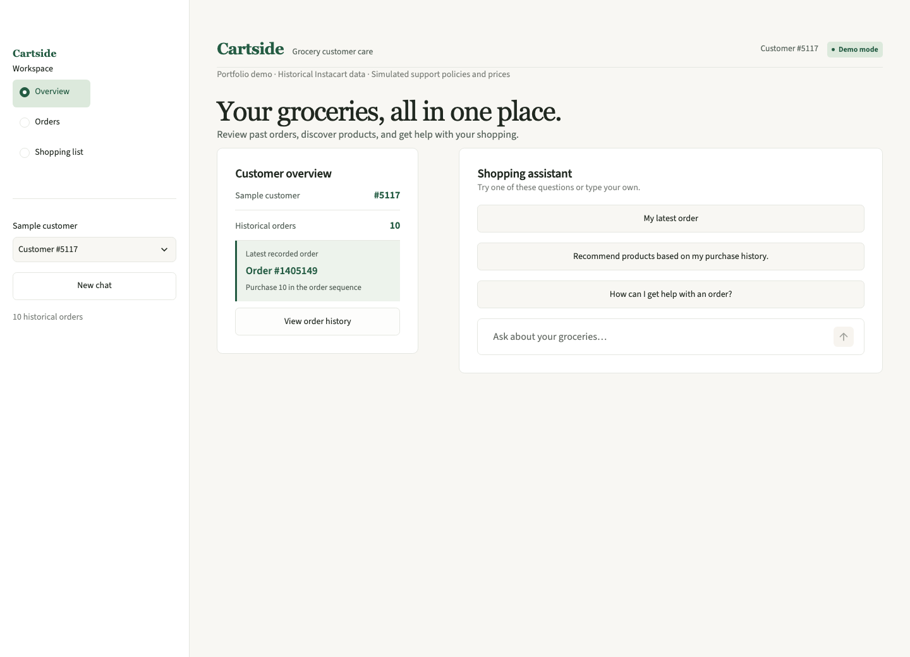
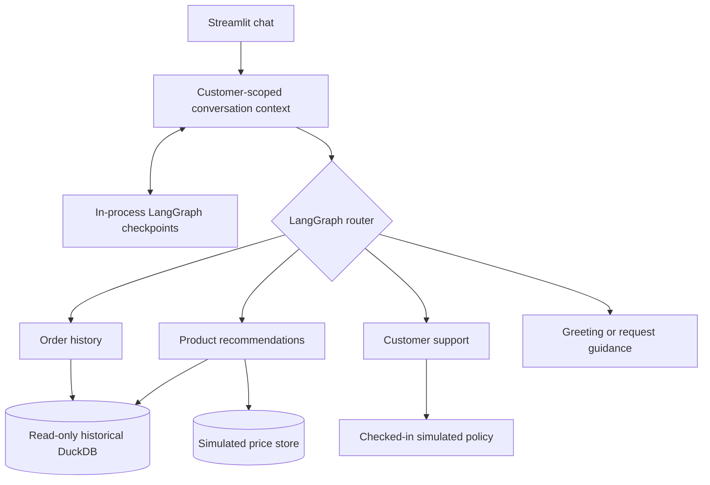
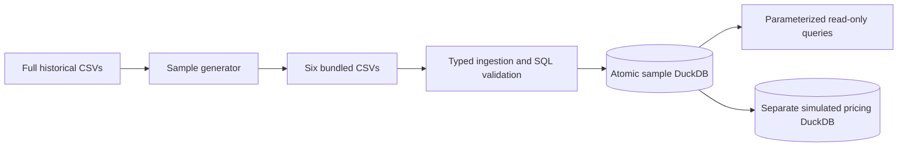

# Cartside — Agentic AI Customer Service

## Project Overview

Cartside is a grocery customer-service prototype that routes chat requests to three LangGraph specialists. It looks up historical orders, recommends products from purchase data, and explains simulated support policies. The Streamlit workspace runs without an API key using an anonymized Instacart sample stored in DuckDB. The project began as a four-person team project for BUS4 118S at San José State University.

## Live Demo

Public deployment is pending verification. [Deployment and release smoke test](DEPLOYMENT.md)

## Workspace preview

Screenshots from the local Streamlit preview using the bundled sample data.



[Recommendations](docs/screenshots/desktop-recommendations.png) · [Order history](docs/screenshots/desktop-orders.png) · [Shopping list](docs/screenshots/desktop-shopping-list.png) · [Phone layout](docs/screenshots/mobile-assistant.png)

## Architecture



Order replies are rendered from rows belonging to the selected customer. Recommendations are ranked in SQL and rendered from verified product IDs. In private OpenAI mode, the model can help route requests and select from the verified candidate IDs. Cartside supplies the factual order and policy content directly, reducing opportunities to invent order details or promise actions.

## Tech Stack

Python 3.13 · Streamlit · DuckDB · LangGraph and MemorySaver · pytest and Ruff · optional OpenAI via LangChain

## Dataset and Data Engineering

The source is the [Instacart Market Basket Analysis dataset](https://www.kaggle.com/datasets/psparks/instacart-market-basket-analysis). It includes roughly 3.4 million order records and 32.4 million prior basket rows, plus a separate training basket file. The checked-in sample contains 10,000 orders, 93,803 prior basket rows, 4,052 training basket rows and 12,207 products.



The builder checks headers, explicit column types, required values, unique keys, foreign-key relationships, basket positions and split membership. The first purchase can have a missing days-since-prior value. DuckDB executes joins, filters and aggregates in SQL. The Streamlit launch reads the bundled sample, and query results contain the selected customer's orders or catalog-level evidence.

The sample generator selects prior and training orders by hashed customer ID, then order sequence. The 10,000-order cutoff can truncate a customer's history. Building from the checked-in CSVs reproduces the demo without downloading raw data. The separate `--dataset full` command is for offline analysis.

## Agent Responsibilities

| Agent | What it does | Evidence |
| --- | --- | --- |
| Order history | Finds available first, latest and specific orders. Checks order ownership and reports missing items or history. | Customer ID, order sequence and purchased product rows. |
| Product recommendation | Suggests repeat purchases ranked by frequency and recency, co-purchases for a named product, or sample-wide popular items when history runs out. | Historical baskets and catalog records. |
| Customer support | Explains the simulated return policy and directs visitors to the original service for real order help. | Checked-in policy and fixed capability messages. |

## Key Features

- Clickable starters for the latest order, personalized products, and order help.
- Follow-up turns remember the referenced order and earlier suggestions. **New chat** and customer changes reset the conversation.
- An **Orders** view shows historical baskets. The **Shopping list** stores selections in the browser session and totals simulated prices in integer cents.
- A public configuration that makes zero paid API calls. Private OpenAI use is opt-in and loopback-only.

## Testing and Reliability

Local verification with Python 3.13 and Streamlit 1.67 passed **95 offline tests**. The suite covers SQL accuracy, startup from clean sample data, routing, multi-turn conversation, customer isolation, invalid inputs, recovery, and the three Streamlit views. Live OpenAI is outside the offline test run. GitHub Actions installs the runtime, builds the sample, runs Ruff and runs pytest.

For customer **5117**, the latest available order is **1405149** and contains Lemon Yogurt, Blueberry Yoghurt and Original No Pulp 100% Florida Orange Juice. The first order is **1662937** and contains four products. The lookup uses `order_number` for chronology.

## Local Setup

```bash
git clone https://github.com/Mohamed254-pixel/Agentic-AI-customer-service.git
cd Agentic-AI-customer-service
python3.13 -m venv .venv
source .venv/bin/activate
python -m pip install -r requirements.txt
DEMO_MODE=1 OPENAI_API_KEY= python -m streamlit run main.py
```

The first app session initializes the sample automatically. To build and test explicitly:

```bash
python -m pip install -r requirements-dev.txt
python scripts/build_db.py --dataset sample
python -m ruff check --select E9,F63,F7,F82 .
DEMO_MODE=1 OPENAI_API_KEY= python -m pytest -q
```

For full historical analysis, place the six raw CSVs in `data/raw/instacart/` and run `python scripts/build_db.py --dataset full`. To download via the existing helper, install `kagglehub` and run `python scripts/download_data.py`. The full-data build is independent of the demo.

## Deployment

Streamlit Community Cloud uses `main.py`, Python 3.13 and the root `requirements.txt`. See [Deployment](DEPLOYMENT.md) for the public release steps, smoke test and private OpenAI configuration.

## Limitations

The demo uses anonymized historical IDs and scopes chat context to the selected demo customer. Anyone can select any sample customer. Sessions and shopping lists are temporary. Prices and support policies are simulated. The app has no live inventory, payments, delivery tracking, order editing, verified ingredient safety or refund processing.

## Future Improvements

- Evaluate recommendation quality on a temporal holdout using the full historical dataset.
- Track changes in SQL query plans as dataset size grows.
- Add browser-driven release checks for desktop and mobile layouts.
